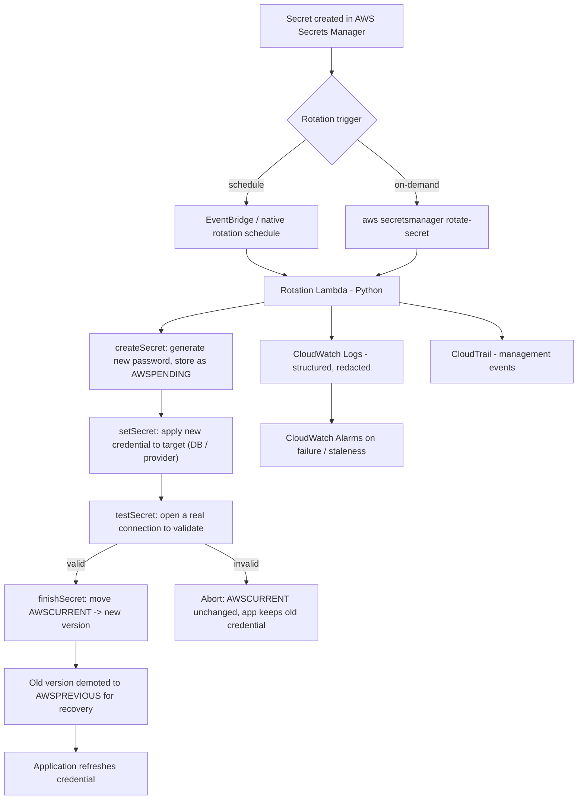
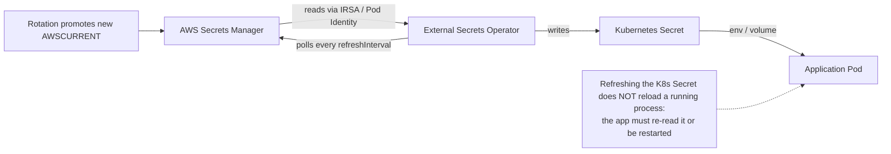

# 📖 Detailed Walkthrough
For a step-by-step guide, including screenshots and more explanations, check out the tutorial on Medium:
[**Automating AWS Secrets Rotation with Terraform, Secrets Manager, Lambda, RDS, and EKS**](https://medium.com/p/962a6b3862d5/)

# Enterprise Secrets Management & Automated Rotation Platform

Automatically rotate database passwords, API keys, and TLS certificates with
AWS Secrets Manager, Python, Kubernetes (EKS), and CI/CD. This platform is
**designed to be deployed, tested, and simulated on AWS** — there is no local
deployment path.

> **What runs where.** Your workstation runs only the developer toolchain:
> install, lint, type check, pure-logic unit tests, and the Lambda package
> build. Everything operational — Secrets Manager, the rotation Lambda, RDS
> PostgreSQL, CloudWatch, EKS + External Secrets Operator — runs on AWS. Nothing
> is deployed and no real rotation runs without an explicit `terraform apply` /
> `aws secretsmanager rotate-secret` against your account (chargeable — see
> `docs/costs.md`). Start with `docs/deployment.md`.

---

## Why this exists (plain language)

Secrets — database passwords, API keys, certificates — are the keys to your
systems. If they never change, a leaked key stays dangerous forever. This
platform makes rotation **automatic, safe, and auditable**:

- **Automatic**: a schedule triggers rotation; no human copies passwords around.
- **Safe**: a new credential is created and *tested* before anything relies on
  it. If the test fails, nothing is promoted and the old credential keeps
  working. We never promote an unvalidated credential.
- **Auditable**: who read or changed a secret, when rotation ran, and whether it
  succeeded are all queryable — without ever logging the secret value itself.

The project deliberately proves more than "store a password in AWS": it shows a
*correct* rotation state machine, failure handling, recovery, and compliance
checking.

---

## Architecture

### Secret rotation flow (database / API)



### Kubernetes secret delivery flow



### Architecture decisions (summary)

- **Rotation logic in a library, not the Lambda.** `src/secrets_rotation/` holds
  the rotation state machine; `lambda/database_rotation/handler.py` is a thin
  adapter. The pure parts (password generation, alternating-users mapping, step
  dispatch, policy, redaction) are unit-tested on the workstation; the full
  lifecycle is verified by AWS integration tests against real Secrets Manager +
  RDS.
- **Alternating users for database rotation.** Two login roles (`myapp_a`,
  `myapp_b`) share privileges; rotation changes the *inactive* one and only
  flips `AWSCURRENT` after a successful connection test. The still-current user
  stays valid throughout, so there is no window where the app is locked out.
  See `docs/database-rotation.md`.
- **External Secrets Operator over the Secrets Store CSI Driver** as the primary
  Kubernetes integration. ESO *synchronizes* Secrets Manager values into native
  Kubernetes `Secret` objects (works with any workload that reads a Secret),
  whereas the CSI Driver *mounts* secret material as files into a pod volume.
  ESO is simpler to adopt incrementally and decouples the app from a CSI mount.
  See `docs/architecture.md` for the full comparison.
- **ACM / cert-manager for certificates, not DIY key export.** Renewing a
  certificate issues new X.509 material signed by a CA; it is not the same as
  overwriting a shared secret. We never export private keys from ACM.
  See `docs/certificates.md`.

---

## Repository layout

```
secrets-rotation-platform/
├── src/secrets_rotation/      # the installable library (pure, testable core)
│   ├── config.py              # naming convention + env-driven settings
│   ├── logging_config.py      # structured JSON logging + secret redaction
│   ├── rotation/              # database, api_credentials, certificates
│   ├── policy/compliance.py   # configurable policy checker
│   ├── audit/reporting.py     # CloudTrail/CloudWatch summarisation
│   └── cli.py                 # `secrets-rotation` command
├── lambda/database_rotation/  # thin Secrets Manager rotation handler
├── scripts/                   # AWS operator scripts (seed / verify / simulate / cleanup / build)
├── tests/
│   ├── unit/                  # pure-logic tests (no AWS)
│   └── integration/           # AWS integration tests (RUN_AWS_INTEGRATION=1)
├── policies/                  # rotation-policy.yaml (configurable thresholds)
├── docs/                      # architecture + per-component deep dives
├── terraform/                 # IaC: modules + environments (network, cicd, dev, eks)
├── kubernetes/                # ESO SecretStore/ExternalSecret + sample app (EKS)
└── .github/workflows/         # CI/CD (GitHub Actions + OIDC)
```

---

## Quick start

The full step-by-step runbook is `docs/deployment.md`. In brief:

**Prerequisites:** Python 3.11+, Git, AWS CLI v2 (+ credentials), Terraform, and
— for the Kubernetes stage — kubectl, Helm, eksctl. See `docs/prerequisites.md`.

### 1. Install the toolchain and run pre-deploy checks (workstation)

```powershell
python -m venv .venv
.\.venv\Scripts\python.exe -m pip install --upgrade pip
.\.venv\Scripts\python.exe -m pip install -e ".[dev]"

.\.venv\Scripts\ruff.exe check src tests lambda scripts   # lint
.\.venv\Scripts\mypy.exe                                   # types
.\.venv\Scripts\python.exe -m pytest tests\unit            # pure-logic unit tests
```

(Git Bash / macOS / Linux: `source .venv/bin/activate`, then `pip install -e
".[dev]"` and `pytest tests/unit`.)

### 2. Deploy to AWS

```powershell
# Build the rotation Lambda package, then deploy with Terraform:
.\.venv\Scripts\python.exe scripts\build_lambda.py --python-version 312 --arch x86_64
cd terraform\environments\dev
Copy-Item terraform.tfvars.example terraform.tfvars   # set region, vpc_id, subnets
terraform init
terraform apply       # CHARGEABLE — review docs/costs.md first
```

### 3. Test and simulate on AWS

```powershell
# Trigger and verify a real rotation:
aws secretsmanager rotate-secret --secret-id dev/myapp/database
.\.venv\Scripts\python.exe scripts\verify_rotation.py --secret-id dev/myapp/database

# Run the AWS integration tests:
$env:RUN_AWS_INTEGRATION="1"; .\.venv\Scripts\python.exe -m pytest -m integration -rs

# Simulate failures and watch recovery:
.\.venv\Scripts\python.exe scripts\simulate_failures.py --secret-id dev/myapp/database
```

See `docs/deployment.md` (deploy) and `docs/testing-and-simulation.md` (test +
simulate) for the complete, annotated procedures.

---

## Security principles (enforced in code)

- **No plaintext secrets anywhere but Secrets Manager / the target system.** Not
  in Terraform vars, source, images, CI logs, tags, or Git. `.gitignore` and
  `.dockerignore` block state files, `.env`, keys, and populated K8s Secrets.
- **Never log secret values.** `logging_config.py` redacts passwords, tokens,
  authorization headers, connection strings, and PEM private keys — proven by
  `tests/unit/test_logging_redaction.py`.
- **Validate before promote.** `testSecret` must succeed or `AWSCURRENT` does
  not move. Verified by the AWS integration test (the rotated credential must
  authenticate against RDS before it is current).
- **Idempotent, retry-safe rotation.** A retried step reuses the pending version
  rather than minting conflicting credentials.
- **Least privilege.** Rotation uses a scoped master secret; app workloads get
  read-only access to their own secrets (enforced in the Terraform/K8s layers).

---

## What runs where

| Capability | Workstation (pre-deploy) | AWS (deploy / test / simulate) |
|---|---|---|
| Lint, types, pure-logic unit tests | yes | — |
| Lambda packaging (`build_lambda.py`) | yes | artifact deployed by Terraform |
| DB rotation lifecycle | — | rotation Lambda + RDS PostgreSQL |
| API credential rotation | — | Secrets Manager (mock provider) |
| Certificate lifecycle | — | ACM / cert-manager |
| Policy checker / audit report | runs CLI | reads live metadata / CloudTrail |
| Kubernetes sync | — | External Secrets Operator on EKS |
| CI/CD | PR quality gate | GitHub Actions + OIDC deploy |

---

## Documentation

- `docs/deployment.md` — **full AWS deploy runbook** (toolchain → Terraform →
  rotation → EKS → CI → teardown).
- `docs/testing-and-simulation.md` — **how to test and simulate failures on
  AWS**, mapped to acceptance criteria.
- `docs/troubleshooting.md` — common errors and fixes by area.
- `docs/portfolio-summary.md` — portfolio narrative + interview talking points.
- `docs/architecture.md` — decisions, ESO vs CSI, event categories.
- `docs/database-rotation.md` — the four steps, alternating users, recovery.
- `docs/api-rotation.md` — provider-side change vs stored-value change.
- `docs/certificates.md` — renewal vs rotation, ACM/cert-manager guidance.
- `docs/kubernetes.md` — ESO flow, refresh caveat, IRSA auth on EKS.
- `docs/cicd.md` — pipeline jobs, OIDC deploy, safety choices.
- `docs/costs.md` — expected charges and what keeps billing after teardown.
- `docs/terraform-state.md` — state risks and secure backend.
- `docs/prerequisites.md` — tool install commands.
- `docs/roadmap.md` — component status map.

---

## Status

The code, infrastructure, Kubernetes manifests, CI/CD pipeline, AWS integration
tests, and failure-simulation drills are complete. Workstation checks pass
(`ruff` clean, `mypy` clean, pure-logic unit suite passing; `terraform fmt`
clean). Deploying to AWS, running the AWS integration tests, and the failure
drills require your AWS account and are chargeable — follow `docs/deployment.md`
and `docs/testing-and-simulation.md`. See `docs/roadmap.md` for the component
status map.
